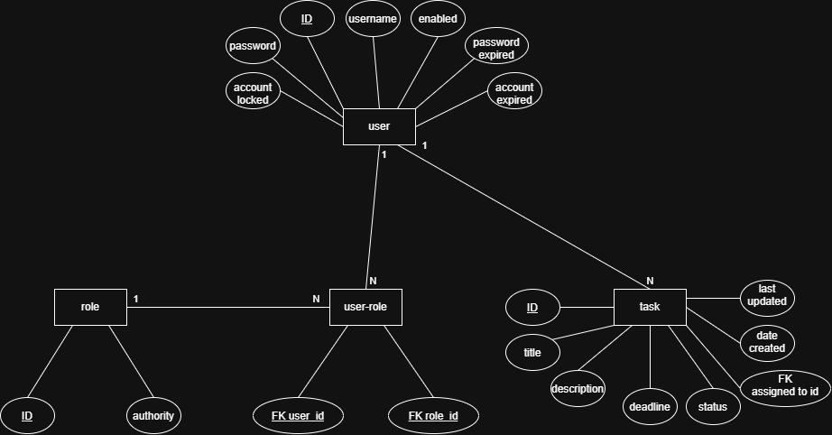

## Task Manager

Final project for the UBS Software Developer Intern Training Plan, built with Grails 7.

## Description

A web application for creating, assigning and tracking tasks. Each task has a title, a deadline, a status (To-Do, In-Progress, Done) and an assigned user. It includes a REST API and role-based access.

## Target users

- Admin: manages all tasks and assigns them to users.
- User: works on the tasks assigned to them and updates their status.

## Features

1. Log in and log out (Spring Security).
2. Create, view, edit and delete tasks.
3. Each task has a title, description, deadline, status and assigned user.
4. Filter the task list by status, with search and pagination.
5. Admin sees and manages all tasks. Users see and manage only their own.
6. Business rule: a new task's deadline can't be in the past.
7. Dashboard with stat cards: tasks To-Do, In-Progress, Done, and overdue.
8. REST API for tasks (JSON, correct status codes, filter by status, pagination), secured with Basic auth.
9. Bootstrap styling and flash messages on every page.

## Tech

Grails 7, Groovy, GORM, MySQL, GSP, Bootstrap 5, Spring Security, Postman.

## ER Diagram

