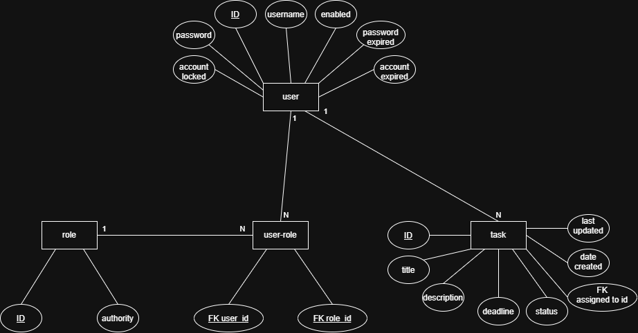

# Task Manager

Final project for the UBS Software Developer Intern Training Plan, built with Grails 7.

## Description

A web application for creating, assigning and tracking tasks. Each task has a title, a deadline, a status (To-Do, In-Progress, Done) and an assigned user. It includes a REST API and role-based access.

## Target users

- Admin: manages all tasks and assigns them to users.
- User: works on the tasks assigned to them and updates their status.

## Features

1. Log in and log out (Spring Security).
2. Create, view, edit and delete tasks.
3. Each task has a title, description, deadline, status and assigned user.
4. Filter the task list by status, with search and pagination.
5. Admin sees and manages all tasks. Users see and manage only their own.
6. Business rule: a new task's deadline can't be in the past.
7. Dashboard with stat cards: tasks To-Do, In-Progress, Done, and overdue.
8. REST API for tasks (JSON, correct status codes, filter by status, pagination), secured with Basic auth.
9. Bootstrap styling and flash messages on every page.

## Tech

Grails 7, Groovy, GORM, MySQL, GSP, Bootstrap 5, Spring Security, Postman.

## ER Diagram



## Running locally (development)

Prerequisites: JDK 21, MySQL 8, Grails 7.0.17.

1. Create the database:
   ```sql
   CREATE DATABASE task_manager;
   ```
2. Check the MySQL username and password in `grails-app/conf/application.yml` (default `root` / `admin`).
3. Run the app:
   ```
   grails run-app
   ```
4. Open http://localhost:8080 and log in.

Tables are created automatically by GORM on first start. `BootStrap.groovy` creates two accounts:

| Email | Password | Role |
|---|---|---|
| admin@ubs.com | admin123 | ROLE_ADMIN |
| intern@ubs.com | intern123 | ROLE_USER |

## Environments

| Environment | Database | dbCreate | Used by |
|---|---|---|---|
| development | MySQL `task_manager` | update | `grails run-app` |
| test | H2 in memory | create-drop | `grails test-app` |
| production | MySQL `ubs_training` | update | the WAR file |

## Deployment

### Prerequisites

- JDK 21
- MySQL 8 with an empty `ubs_training` database: `CREATE DATABASE ubs_training;`
- Apache Tomcat 10 or newer

### Configuration

The production datasource is in `grails-app/conf/application.yml` under `environments.production`. Change the URL, username or password there if the server's MySQL differs.

### Build

```
grails war
```

Take `build/libs/taskmanager-0.1.war` and move it into the webapps folder in the server's tomcat to run it.

### Deploy


1. Start Tomcat:
   ```
   cd C:\tomcat\apache-tomcat-10.1.61\bin
   set JAVA_HOME=C:\Program Files\Java\jdk-21
   startup.bat
   ```
2. Wait for `Deployment of web application archive [...taskmanager.war] has finished` in the Tomcat log.
3. Open http://localhost:8080/taskmanager/

To stop Tomcat, run `shutdown.bat` in the same folder.
